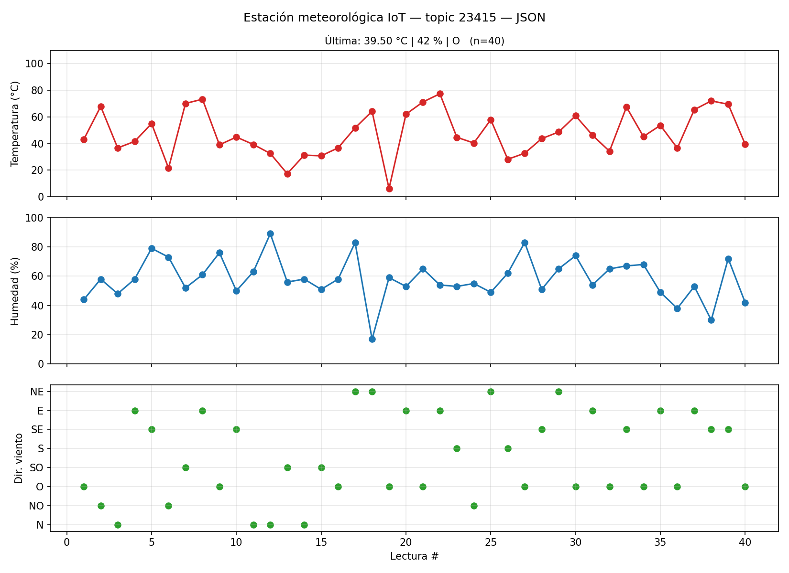

# Estación Meteorológica IoT — CC3067 Redes

Topic: `23415` · Broker: `161.35.11.141:9092` (SASL_PLAINTEXT / PLAIN)

## Instalación
```bash
pip install -r requirements.txt
```

## Ejecución (dos terminales)
```bash
# Terminal 1 — consumidor con gráfica en vivo
python consumer.py --save grafica.png

# Terminal 2 — productor (cada 15-30 s)
python producer.py              # JSON
python producer.py --compact    # payload de 3 bytes (sección 3.4)
python producer.py --min 2 --max 4   # intervalo corto solo para probar
```

El consumidor reconoce los dos formatos (3 bytes → `decode`, si no → JSON) y lee desde el inicio del topic.
Con `--latest` lee solo mensajes nuevos.

## Archivos
- `common.py`: configuración de Kafka, sensores simulados (normal μ=55, σ=15, recortada al rango), JSON y `encode`/`decode` de 3 bytes.
- `producer.py`: dispositivo IoT, corre hasta Ctrl+C.
- `consumer.py`: suscriptor que actualiza la gráfica con cada mensaje.

## Codificación de 3 bytes (24 bits)
| bits 23–10 | bits 9–3 | bits 2–0 |
|---|---|---|
| temperatura × 100 (0–11000 < 2¹⁴) | humedad (0–100 < 2⁷) | dirección del viento (índice 0–7) |

## Colab
`EstacionMeteorologica_23415.ipynb` corre el productor (en un hilo) y el consumidor con la gráfica en vivo dentro de un mismo notebook. Usa **Entorno de ejecución → Ejecutar todo**.

## Evidencia

